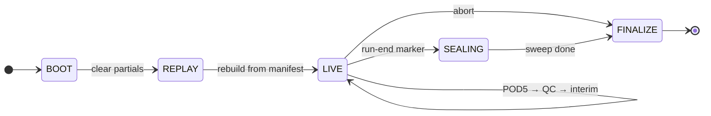

# mRNAspect — architecture

```mermaid
flowchart LR
  subgraph IN["Input"]
    Src["POD5 / basecalled BAM<br/><small>aligned or not</small>"]
    Cfg["run_config.yaml<br/><small>model · reference · flags</small>"]
  end

  subgraph DRV["Drivers"]
    Off["OfflinePipeline<br/><small>sorted glob</small>"]
    RT["RealtimePipeline<br/><small>watcher → queue</small>"]
    One["_process_one_input()<br/><small>shared body</small>"]
  end

  subgraph PREP["Basecall → Align"]
    BC["dorado-server<br/><small>GPU · cached</small>"]
    AL["minimap2<br/><small>k7 w5</small>"]
  end

  subgraph AN["Streaming QC"]
    Eng["AnalysisEngine<br/><small>read-by-read</small>"]
    Run["Run summary · PolyA"]
    Trk["Per-construct track<br/><small>pileup · MAPQ · PolyA</small>"]
    Un["Unassigned<br/><small>unmapped / off-ref</small>"]
    Ident["Per-base identity"]
    Hot["Error hotspots"]
    Bun["snapshot bundle"]
  end

  subgraph REP["Report"]
    Rpt["CoAReporter"]
    Wr["summary_writer<br/><small>+ provenance</small>"]
  end

  subgraph OUT["Output"]
    CoA["QC report HTML/PDF"]
    JSON["qc_result.json"]
    Snap["snapshots · manifest<br/><small>restart / recovery</small>"]
  end

  Src --> Off
  Src --> RT
  Cfg --> Off
  Cfg --> RT
  Off --> One
  RT --> One
  One -->|"POD5"| BC --> AL --> Eng
  One -->|"BAM"| AL
  Eng --> Run
  Eng --> Trk
  Eng --> Un
  Trk --> Ident
  Trk --> Hot
  Run --> Bun
  Ident --> Bun
  Hot --> Bun
  Un --> Bun
  Bun --> Rpt --> CoA
  Bun --> Wr --> JSON
  One -.-> Snap
  Snap -.->|"restart"| One

  classDef nIn   fill:#FFFFFF,stroke:#64748B,stroke-width:1.5px,color:#0F172A;
  classDef nDrv  fill:#FFFFFF,stroke:#1976D2,stroke-width:1.5px,color:#0F172A;
  classDef nPrep fill:#FFFFFF,stroke:#00796B,stroke-width:1.5px,color:#0F172A;
  classDef nAn   fill:#FFFFFF,stroke:#512DA8,stroke-width:1.5px,color:#0F172A;
  classDef nRep  fill:#FFFFFF,stroke:#F59E0B,stroke-width:1.5px,color:#0F172A;
  classDef nOut  fill:#FFFFFF,stroke:#455A64,stroke-width:1.5px,color:#0F172A;
  class Src,Cfg nIn
  class Off,RT,One nDrv
  class BC,AL nPrep
  class Eng,Run,Trk,Un,Ident,Hot,Bun nAn
  class Rpt,Wr nRep
  class CoA,JSON,Snap nOut

  style IN fill:#EDF1F6,stroke:#94A3B8,stroke-width:1.5px,color:#0F172A
  style DRV fill:#E3F2FD,stroke:#64B5F6,stroke-width:1.5px,color:#0F172A
  style PREP fill:#D2ECE8,stroke:#00695C,stroke-width:3px,color:#0F172A
  style AN fill:#E7DDF7,stroke:#4527A0,stroke-width:3px,color:#0F172A
  style REP fill:#FFF8E1,stroke:#F59E0B,stroke-width:2px,color:#0F172A
  style OUT fill:#E4E8EB,stroke:#90A4AE,stroke-width:1.5px,color:#0F172A
```

## Real-time lifecycle

## Where each box lives

| Box | Source |
| --- | --- |
| `OfflinePipeline` · `_process_one_input` | `main.py` |
| `RealtimePipeline` + watcher / backpressure / manifest / sealing | `realtime/` |
| abort · checkpoint · ordering · reference check | `runtime/` |
| dorado-server · minimap2 | `wrappers/` |
| engine · pileup · QC modules · integrator | `analysis/` |
| `CoAReporter` · `summary_writer` | `reporting/` |

This diagram stops at Core's edge. What passes between Core and the desktop app --
the argument surface, the configuration layers, run naming, and the rules the shell
must not re-implement -- is [gui_core_contract.md](gui_core_contract.md).

Detail dropped from this view — the 30 s stability window, backpressure decimation, replay
integrity asserts, `verify_partition`, the m1Ψ consensus modes — is documented in each
module's docstring.

## Detailed Version 
flowchart LR
  subgraph INPUT["Input"]
    RunDir["MinKNOW run dir <small>run_dir/pod5/*.pod5 run_dir/final_summary_*.txt (run-end marker)</small>"]
    InputDir["Offline input dir <small>*.pod5 (pod5 mode) · *.bam (bam mode)</small>"]
    RefFasta["Reference FASTA <small>panel of constructs; validated at t=0</small>"]
    ModelDir["Basecaller model folder <small>dorado-server --model stock hac@v5.3.0 or an exported fine-tune</small>"]
    LoadConfig["load_config() <small>shipped run_config.yaml → --config → CLI effective config is the provenance record</small>"]
  end

  subgraph DRIVERS["Drivers — one shared per-input body"]
    subgraph OFFLINE["main.py — OfflinePipeline"]
      Discover["_discover_inputs() <small>natural_sorted() glob, acquisition order runtime/ordering.py</small>"]
      Cadence["interim cadence <small>every N inputs (deterministic) optional wall-clock; gated by min_reads</small>"]
      Resume["resume_from_snapshot() <small>recovery after SIGKILL/OOM refuses to overwrite a run_end report</small>"]
    end

    subgraph REALTIME["realtime/ — RealtimePipeline"]
      Watcher["DirectoryWatcher (thread) <small>polling + size stabilization 7 polls x 5 s = 30 s verified silence marker closes the input set, never stops the scan</small>"]
      Queue["queue.Queue <small>1 producer thread → main thread engine touched by one thread only</small>"]
      BP["Backpressure <small>always reports lag; thins at max_queue_depth=4 — every s-th arrival, uniform in run time (never prefix-truncate). sampling=true: thinned inputs are never analysed and the report's banner says so</small>"]
      Manifest["IngestManifest <small>ingest_manifest.tsv — append-only replay log REPLAY rebuilds the engine; asserts primary_total_after per line. Not a skip-set.</small>"]
      Sealer["RunSealer + build_run_accounting() <small>run-end sweep, 3 x 2 s window, seal budget every POD5 lands in exactly one bucket or the accounting refuses to return</small>"]
    end

    ProcessOne["_process_one_input() <small>THE shared body: basecall → align → ingest timing · durability · on_error policy</small>"]
    Abort["AbortFlag + signal handlers <small>runtime/lifecycle.py — SIGINT/SIGTERM set a flag, never raise; finalize as user_abort</small>"]
    RefCheck["reference_contigs() <small>runtime/reference_check.py — refuse an empty/ unparseable FASTA before any GPU time</small>"]
  end

  subgraph PREP["Input processing <small>basecall: pod5 mode only; align: both modes — bam mode links the input BAM into basecall_prefix/ and discards any alignment it already holds</small>"]
    Basecall["shell_basecall() <small>wrappers/run_basecall.sh → dorado-server (GPU) POD5 → basecall_prefix/ ubam dir child in a new session: Ctrl-C never kills it</small>"]
    Ckpt["Checkpoint <small>runtime/checkpoint.py · basecall_cache.tsv skips re-BASECALL only — never re-ingest (H2)</small>"]
    Align["shell_align() <small>wrappers/run_align.sh → minimap2 + samtools -ax map-ont -k7 -w5 --secondary=no -y -t align.threads always re-run: cheap, never stale mv carried only with basecall.emit_moves primary reads in = out, or the input fails</small>"]
  end

  subgraph ANALYZE["Streaming QC analysis <small>update(read) · snapshot() · finalize() — O(1) or O(ref_len) memory</small>"]
    Engine["AnalysisEngine.ingest_bam() <small>pysam, read-by-read; per-read guard @SQ vs reference cross-check on first BAM</small>"]
    RunLevel["Run level <small>RunSummaryModule + PolyAModule see EVERY record</small>"]
    Router["Bucket router <small>every PRIMARY read → exactly one bucket tracks created lazily, capped by max_constructs</small>"]

    subgraph TRACK["_ConstructTrack — one per reference contig (Track B)"]
      Pileup["SharedPileup <small>position x base counts via CIGAR walk O(ref_length), one per construct</small>"]
      Consensus["ConsensusIdentityModule <small>identity % and its substitution / deletion / insertion rates, positions flagged by mismatch rate every reference position scored, U included</small>"]
      Hotspot["ErrorHotspotModule <small>per-position error rate + top-N positions by error (a per-model, per-arm null: none built yet)</small>"]
      TrackPerRead["RunSummary · PolyA · MAPQ <small>same classes as run level, over this subset MAPQ: ambiguity under --secondary=no</small>"]
    end

    Unassigned["_UnassignedTrack <small>unmapped or off-reference (most reads on QK-01) read_stats + polya + off_reference_contigs</small>"]
    Verify["verify_partition() <small>constructs + unassigned == primary_total slack only up to unprocessable; raises otherwise</small>"]
    Bundle["snapshot bundle <small>{module: snapshot}, owned by the reporter keys from snapshot_keys.py (construct:ref, unassigned)</small>"]
    Integrator["QCResultIntegrator <small>bundle → qc_metrics; degrade to not_measured, never fabricate; acceptance thresholds deferred</small>"]
  end

  subgraph REPORT["Reporting + durability"]
    Reporter["CoAReporter <small>report(label) interim · finalize(reason) terminal min_reads sufficiency gate, force-able jinja2 + weasyprint + matplotlib figures</small>"]
    Writer["summary_writer <small>dump_latest_snapshot() after EVERY input (atomic) write_result_json() once at finalize</small>"]
    Prov["provenance (Tier-A stamp) <small>git commit + dirty flag, command, inputs, params</small>"]
  end

  subgraph OUT["Outputs"]
    qc_json["qc_result.json <small>bundle + qc_metrics + run_accounting, stamped</small>"]
    coa["report_LABEL.html / .pdf <small>interim_k · run_end · user_abort</small>"]
    interim_json["interim_k_snapshot.json"]
    latest_json["latest_snapshot.json <small>durability; the source for --resume-from-snapshot</small>"]
    manifest_tsv["ingest_manifest.tsv"]
    cache_tsv["basecall_cache.tsv"]
    runlog["run.log <small>Tier-B operator log</small>"]
  end

  subgraph HARNESS["Test harness — Tier B, never backs a number"]
    Mimic["MinKNOWMimic <small>realtime/mimic.py — replays recorded runs' file-writing behaviour (marker_gap_s, faults)</small>"]
  end

  %% input → config → drivers
  LoadConfig --> Discover
  LoadConfig --> Watcher
  LoadConfig -.->|"basecall.model"| Basecall
  LoadConfig -.->|"align.minimap2_flags"| Align
  ModelDir --> LoadConfig
  RefFasta --> RefCheck
  RefCheck -->|"contig set"| Engine
  InputDir --> Discover
  RunDir --> Watcher
  Mimic -.->|"writes POD5s + marker"| RunDir

  %% offline feed
  Discover -->|"sorted list"| ProcessOne
  ProcessOne --> Cadence
  Cadence -.->|"_emit_interim()"| Reporter
  latest_json -.->|"no re-ingest"| Resume
  Resume --> Reporter

  %% real-time feed
  Watcher -->|"FileReadyEvent"| BP
  BP -->|"admit"| Queue
  BP -.->|"defer (re-swept at run-end)"| Sealer
  Queue -->|"main thread"| ProcessOne
  Manifest -.->|"REPLAY: re-ingest cached BAMs"| Engine
  ProcessOne -->|"append entry"| Manifest
  Sealer --> ProcessOne
  Watcher -.->|"run-end marker → set flag"| Sealer

  %% shared per-input body
  Abort -.->|"stop between inputs"| ProcessOne
  ProcessOne -->|"pod5 mode"| Basecall
  ProcessOne -->|"bam mode: input BAM"| Align
  Ckpt -.->|"cached ubam → skip GPU"| Basecall
  Basecall -.->|"record on atomic completion"| Ckpt
  Basecall -->|"ubam dir"| Align
  Align -->|"aligned BAM"| Engine
  ProcessOne -.->|"after every input"| Writer

  %% analysis
  Engine --> RunLevel
  Engine --> Router
  Router -->|"mapped to a reference contig"| Pileup
  Router -->|"mapped to a reference contig"| TrackPerRead
  Router -->|"unmapped / off-reference"| Unassigned
  Pileup --> Consensus
  Pileup --> Hotspot
  RunLevel --> Bundle
  Consensus --> Bundle
  Hotspot --> Bundle
  TrackPerRead --> Bundle
  Unassigned --> Bundle
  Verify -.->|"checked at finalize_all(), before snapshots"| Bundle

  %% report + durability
  Bundle -->|"raw snapshots"| Reporter
  Bundle --> Integrator
  Integrator -->|"qc_metrics"| Writer
  Bundle -.->|"raw snapshots"| Writer
  Prov --> Writer
  Sealer -.->|"run_accounting"| Writer
  Reporter --> coa
  Reporter -.-> interim_json
  Writer --> qc_json
  Writer --> latest_json
  Manifest --> manifest_tsv
  Ckpt --> cache_tsv
  DRIVERS -.->|"logging FileHandler"| runlog

  %% node styles — neutral (near-white) nodes; stroke matches the stage
  classDef nInput   fill:#FFFFFF,stroke:#64748B,stroke-width:1.5px,color:#0F172A;
  classDef nDriver  fill:#FFFFFF,stroke:#1976D2,stroke-width:1.5px,color:#0F172A;
  classDef nPrep    fill:#FFFFFF,stroke:#00796B,stroke-width:1.5px,color:#0F172A;
  classDef nAnalyze fill:#FFFFFF,stroke:#512DA8,stroke-width:1.5px,color:#0F172A;
  classDef nReport  fill:#FFFFFF,stroke:#F59E0B,stroke-width:1.5px,color:#0F172A;
  classDef nOut     fill:#FFFFFF,stroke:#455A64,stroke-width:1.5px,color:#0F172A;
  classDef nTest    fill:#FFFFFF,stroke:#B0BEC5,stroke-width:1.5px,color:#455A64;
  class RunDir,InputDir,RefFasta,ModelDir,LoadConfig nInput
  class Discover,Cadence,Resume,Watcher,Queue,BP,Manifest,Sealer,ProcessOne,Abort,RefCheck nDriver
  class Basecall,Ckpt,Align nPrep
  class Engine,RunLevel,Router,Pileup,Consensus,Hotspot,TrackPerRead,Unassigned,Verify,Bundle,Integrator nAnalyze
  class Reporter,Writer,Prov nReport
  class qc_json,coa,interim_json,latest_json,manifest_tsv,cache_tsv,runlog nOut
  class Mimic nTest

  %% subgraph styles — the two core stages (the paper's contributions) carry the thick
  %% accent border; IO/driver plumbing stays thin so the eye lands on them.
  style INPUT fill:#EDF1F6,stroke:#94A3B8,stroke-width:1.5px,color:#0F172A
  style DRIVERS fill:#E3F2FD,stroke:#64B5F6,stroke-width:2px,color:#0F172A
  style OFFLINE fill:#EFF7FE,stroke:#90CAF9,stroke-width:1px,color:#0F172A
  style REALTIME fill:#EFF7FE,stroke:#90CAF9,stroke-width:1px,color:#0F172A
  style PREP fill:#D2ECE8,stroke:#00695C,stroke-width:3px,color:#0F172A
  style ANALYZE fill:#E7DDF7,stroke:#4527A0,stroke-width:3px,color:#0F172A
  style TRACK fill:#F3EFFA,stroke:#7E57C2,stroke-width:1px,color:#0F172A
  style REPORT fill:#FFF8E1,stroke:#F59E0B,stroke-width:2px,color:#0F172A
  style OUT fill:#E4E8EB,stroke:#90A4AE,stroke-width:1.5px,color:#0F172A
  style HARNESS fill:#F5F5F5,stroke:#CFD8DC,stroke-width:1px,color:#455A64